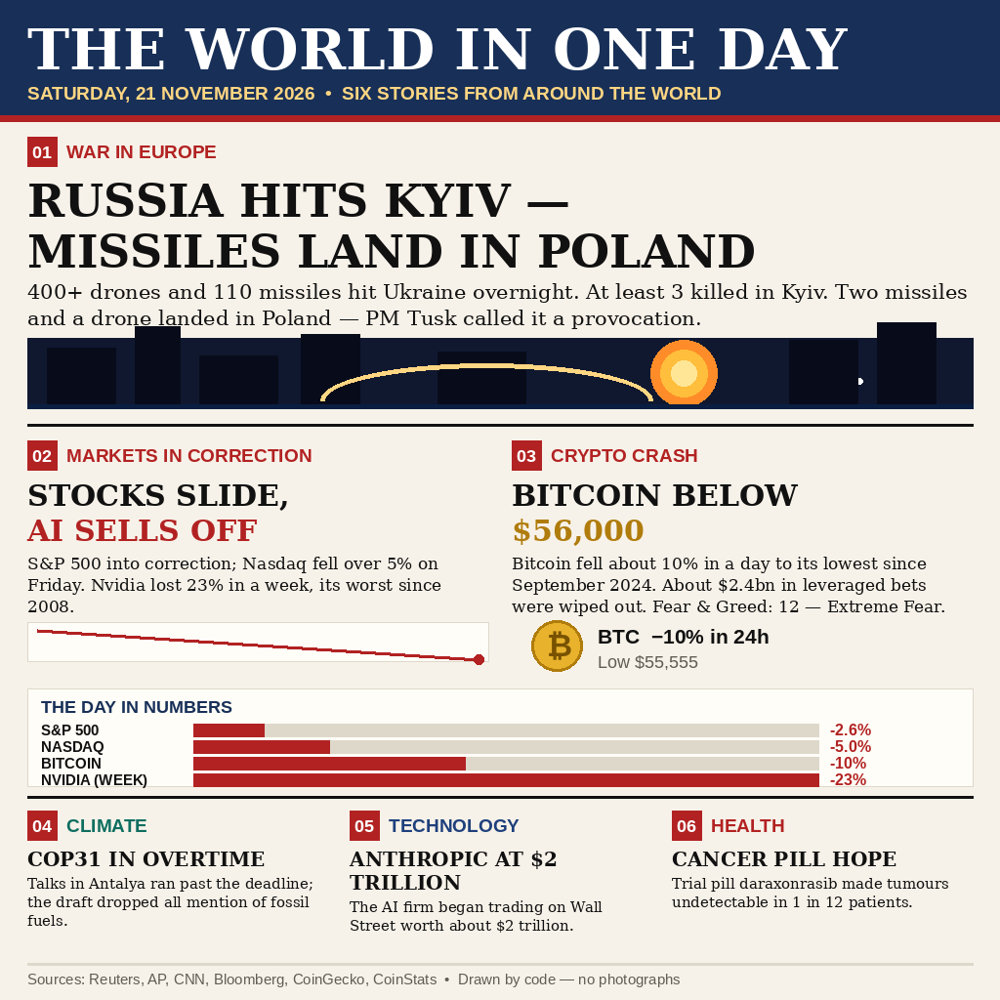

# The World in One Day — 21 November 2026

[](https://make.fun/bounty/news-image-20261121)
[](https://make.fun)
[](https://opensource.org/licenses/MIT)

A one-page newspaper image summing up **Saturday, 21 November 2026** —
built for the [make.fun](https://make.fun/bounty/news-image-20261121)
bounty *"Sum up 21 November's world news in one image"* ($100, 50 prizes).



## The six stories

1. **War in Europe** — Russia fired 400+ drones and 110 missiles at Ukraine
   overnight; at least 3 killed in Kyiv as bridges were hit. Two missiles
   and a drone came down in Poland — PM Tusk called it a deliberate
   provocation.
2. **Markets in correction** — the S&P 500 slid into correction; the Nasdaq
   fell over 5% on Friday. Nvidia lost 23% in a week, its worst since 2008.
3. **Crypto crash** — Bitcoin fell about 10% in a day to below $56,000, its
   lowest since September 2024. About $2.4bn in leveraged bets were wiped
   out. Fear & Greed: 12 — Extreme Fear.
4. **Climate** — COP31 in Antalya ran past its Friday deadline; the draft
   deal dropped all mention of fossil fuels.
5. **Technology** — Anthropic began trading on Wall Street as a company
   worth about $2 trillion.
6. **Health** — trial pill daraxonrasib made pancreatic tumours
   undetectable on scans in 1 in 12 patients.

A "Day in numbers" panel charts the falls: S&P 500 −2.6%, Nasdaq −5.0%,
Bitcoin −10%, Nvidia (week) −23%.

## How the image was made

Every picture in the image was drawn by code — there are no photographs.
The drawing program is a local Pillow script that renders the
1024×1024 PNG, deterministically, from the six verified stories above;
it ran in the build session that produced `entry.png`.

The entry program itself is `main.ts` (Node 22, standard library only):
it copies `entry.png` to the grader's output directory and verifies the
copy byte-for-byte with a SHA-256 check.

```sh
mkdir -p out && MAKEFUN_OUTPUT_DIR=out node main.ts
# writes out/entry.png (1024×1024, under 1 MiB)
```

## Facts and sources

All facts were checked against reporting of 21 November 2026 from
Reuters, AP, CNN, Bloomberg, CoinGecko and CoinStats. Figures are the
day's reported numbers; where outlets differed, the conservative figure
was used (for example, "at least 3 killed" in Kyiv, per AP).

## License

MIT — see [LICENSE](LICENSE).
